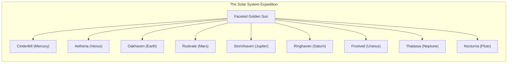
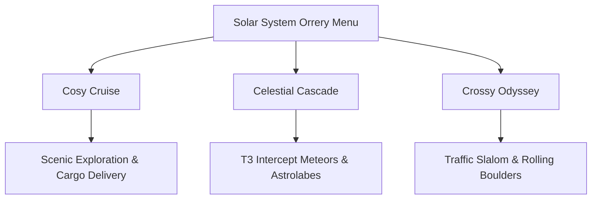

# OVER THE HORIZON

<div align="center">


**An Alpine & 9-Planet Low-Poly Driving Odyssey under Spherical Gravity**

[Play Online](#quick-start) • [Solar System](#the-9-planet-solar-system) • [Game Modes](#tri-mode-arcade-suite) • [Controls](#controls-guide) • [Architecture](docs/ARCHITECTURE.md) • [Contributing](CONTRIBUTING.md)

</div>

---

## Overview

**Over The Horizon** is a stylized, spherical-gravity planetary exploration and arcade driving game. Built with a warm, tactile low-poly diorama aesthetic inspired by *Art of Rally*, *Firewatch*, and *A Short Hike*, players traverse the curved horizon of miniature worlds in bespoke off-road exploration rigs.

Anchored by **Planet Oakhaven** (an Earth-like alpine national park with lush pine forests, rushing crystal streams, and rustic log cabins), the expedition expands across an entire **9-planet solar system** with distinct geological biomes, atmospheric weather conditions, and unique exploration vehicles.



---

## Key Features

- **True Spherical Gravity Physics**: Vehicles traverse 360° spherical globes under continuous center-point radial gravity, featuring 4-wheel independent spring-damper suspension, terrain-normal raycast alignment, and Ackermann steering.
- **Continuous Planetary Road Networks & 7.5m+ Safety Corridors**: Every planet features an analytically curved, continuous two-lane driving highway leveled with an 8.4m flat roadbed and 10m shoulder blend. All architectural landmarks, research domes, energy pylons, and verification markers are mathematically positioned outside a 7.5m safety exclusion zone using true 3D surface-orthogonal vectors (`_getRoadRight`).
- **Autopilot 2.0 with ADAS Guidance**: Smart autonomous road-following powered by 4.5m forward predictive lookahead, obstacle proximity radar steering repulsion, collision deflection resilience without throttle cut, and an automatic reverse-and-pivot unstuck watchdog.
- **9-Planet Solar System**: A complete interplanetary roster featuring scorched volcanic basalt, golden sulfuric smog, alpine pine forests, crimson dunes, gas giant bands, low-poly 3D rings, methane ice, deep oceanic swells, and nitrogen spires.
- **Unique Vehicle for Every World**: Drive 9 tailored exploration machines—from the rugged vintage *TrailScout 4x4 Rig* and heavy *Obsidian Lava Crawler* to the agile *Cryo-Glider Half-Track* and amphibious *Aquanaut Sub-Rover*.
- **Tri-Mode Gameplay**:
  - **Cosy Cruise**: Freeform scenic exploration, cargo delivery outposts, and relaxing time-of-day scrubbing with zero pressure.
  - **Celestial Cascade**: T3 Intercept sky hazards, ground astrolabe reticles, near-miss nitro surges, collectible stardust shards, and stationary lock-on sentries.
  - **Crossy Odyssey**: Reflex-driven traffic slaloms, rolling mountain boulders, and clean crossing combo multipliers.
- **Diegetic 3D Planetary Carousel Menu**: Direct, unobstructed view of the low-poly 3D globe as the central interactive object, featuring quick-swipe planet switching, sound calibration drawer, and tactile candy amber launch button.
- **Interactive 360° Camera & Cockpit POV**: Full touch and mouse orbit drag with smooth inertial momentum, ground-clipping protection, and restricted wide-angle driver cockpit view ($\pm 75^\circ$ azimuth).
- **Edge-to-Edge Mobile & PWA Scaffold**: Fully responsive layout with left-docked speedometer thumb zone, notch/Dynamic Island safe area padding, and zero top blur.
- **Expedition Manual & Dev Dossier (`#about-modal`)**: In-game dual-tab handbook covering gameplay mechanics, vehicle chassis blueprints, creator journey, and live project telemetry.
- **Procedural Web Audio Engine**: 100% mathematical real-time audio synthesis (0KB downloads, zero external audio assets) with vehicle RPM-frequency tracking, procedural tire noise, and 9 modal planetary soundtracks.
- **Microsoft Clarity Session Analytics**: Integrated user journey tracking, heatmaps, and session diagnostics (Project ID `yznpugasgn`).
- **100% Emoji-Free User Interface**: All telemetry, headers, rankings, weather toggles, and notification toasts utilize crisp, bespoke SVG vectors.
- **Zero-Build, Pure WebGL / Three.js**: Runs directly in any modern browser via native HTML5 Import Maps and ES modules—no node build steps, bundlers, or compilation required.

---

## The 9-Planet Solar System

| Planet | Solar Index | Celestial Counterpart | Biome & Atmosphere | Bespoke Vehicle |
| :--- | :---: | :--- | :--- | :--- |
| **Cinderfell** | 1 | Mercury | Scorched basalt, glowing lava fissures, high heat | *Obsidian Lava Crawler* |
| **Aetheria** | 2 | Venus | Golden dense swirling smog, high atmospheric pressure | *Aether Stratospheric Skimmer* |
| **Oakhaven** | 3 | Earth | Alpine diorama, faceted pines, cascading waterfalls | *TrailScout 4x4 Rig* |
| **Rustvale** | 4 | Mars | Crimson canyons, orange sand dunes, dry ice caps | *Valkyrie Dune Rover* |
| **Stormhaven** | 5 | Jupiter | Colossal gas giant, chromatic storm bands, vortex | *Titan Cloud Hauler* |
| **Ringhaven** | 6 | Saturn | Low-poly golden globe with 3D faceted orbital rings | *RingStrider Buggy* |
| **Frostveil** | 7 | Uranus | Cyan methane ice diorama with 82° tilted rings | *Cryo-Glider Half-Track* |
| **Thalassa** | 8 | Neptune | Cobalt ocean currents, high-velocity atmospheric gale | *Aquanaut Sub-Rover* |
| **Nocturna** | 9 | Pluto | Outer nitrogen ice plains, crystalline spires | *Nocturne Crystalline Surveyor* |

---

## Tri-Mode Arcade Suite



### 1. Cosy Cruise
Enjoy unhurried exploration across winding mountain passes, deliver cargo between remote outposts, and adjust the environment in real-time. Use the **Atmosphere Dial** to scrub the 24-hour diurnal sun cycle and toggle weather states between Sun, Rain, Snow, and Dust.

### 2. Celestial Cascade
Survive orbital sky hazards governed by **T3 predictive intercept trajectories**. Rotating golden astrolabe reticles telegraph impact zones 2.5s in advance. Idling for more than 1 second triggers an audible stationary lock-on siren. Skimming within 3 meters of an active blast triggers a **Near-Miss Surge (+150 pts and 22% nitro refill)**. Collect scattered stardust shards to sustain your combo multiplier.

### 3. Crossy Odyssey
Navigate busy multi-lane transport convoys traversing planetary crossings and dodge giant faceted boulders rolling down mountain ridges. Thread gaps cleanly to build weave streaks and unlock Master S-tier rankings.

---

## Controls Guide

### Keyboard & Mouse
| Input | Action |
| :--- | :--- |
| <kbd>W</kbd> / <kbd>↑</kbd> | Accelerate Forward |
| <kbd>S</kbd> / <kbd>↓</kbd> | Brakes / Reverse |
| <kbd>A</kbd> / <kbd>←</kbd> | Steer Left |
| <kbd>D</kbd> / <kbd>→</kbd> | Steer Right |
| <kbd>SPACE</kbd> | Nitro Energy Boost |
| <kbd>C</kbd> | Cycle Camera (Chase, Orbit, Cockpit) |
| <kbd>P</kbd> | Autopilot Cruise Assist |
| <kbd>H</kbd> | Auxiliary Horn |
| <kbd>M</kbd> | Open 3D Solar System Orrery Map |

### Mobile & Touch Devices
On touch screens, an on-screen virtual steering pad and tactile action buttons (**NITRO**, **BRAKE**, **GAS**) automatically activate.

---

## Quick Start (Zero Build Required)

Because **Over The Horizon** uses native HTML5 Import Maps and ES6 modules, no build tools or package managers are required.

### 1. Clone the Repository
```bash
git clone https://github.com/your-username/over-the-horizon.git
cd over-the-horizon
```

### 2. Launch Local Static HTTP Server
```bash
# Using Python 3 (built into macOS and Linux)
python3 -m http.server 8080

# Or using Node.js
npx serve -l 8080 .

# Or using PHP
php -S localhost:8080
```

### 3. Open in Browser
Navigate to `http://localhost:8080` in Chrome, Firefox, Safari, or Edge.

---

## Technical Architecture

```
over-the-horizon/
├── assets/                  # Previews, sound samples, and visual media
│   └── previews/            # 9-planet scenic docket snapshots
├── concept_art/             # Concept artwork and visual development
├── docs/                    # Architectural and design documentation
│   ├── ARCHITECTURE.md      # Engine systems, loop, and physics breakdown
│   └── GAME_DESIGN_DOCUMENT.md # Complete 9-planet design document
├── libs/                    # Zero-installation vendor libraries (Three.js r128)
├── src/js/                  # Game engine ES modules
│   ├── app.js               # Main game coordinator, loop, & camera controller
│   ├── arcade_engine.js     # Tri-mode logic (Cosy Cruise, Cascade, Crossy)
│   ├── audio.js             # Procedural Web Audio synthesizer (engine, nitro, chime)
│   ├── hud.js               # Telemetry cluster, solar orrery menu, & modal coordinator
│   ├── icons.js             # Crisp vector SVG icon library (zero emojis)
│   ├── models.js            # 3D low-poly vehicle models & assembly builders
│   ├── physics.js           # 4-wheel raycast suspension, spherical kinematics, & Autopilot 2.0
│   ├── planet.js            # Spherical terrain generator, 9 biomes, bespoke road curves, & props
│   ├── postprocessing.js    # Cinematic bloom, vignette, & depth color grading
│   └── weather.js           # Dynamic diurnal cycle, particle weather, & lighting
├── styles/
│   └── main.css             # Low-poly tactile HUD, keycaps, and solar orrery styling
├── index.html               # Main entrypoint & HTML5 import map
├── CHANGELOG.md             # Version history and release notes
├── CODE_OF_CONDUCT.md       # Contributor Covenant Code of Conduct
├── CONTRIBUTING.md          # Open source contributor guide
├── LICENSE                  # MIT License
├── README.md                # Master documentation (this file)
└── SECURITY.md              # Security policy and vulnerability disclosure
```

For an in-depth breakdown of the spherical gravity equations, raycast suspension matrix, particle occlusion shaders, and procedural Web Audio synthesis, read [docs/ARCHITECTURE.md](docs/ARCHITECTURE.md).

---

## Automated Verification

The repository includes automated headless Chrome DevTools Protocol (CDP) test scripts to verify visual fidelity, physics response, and UI standards:

```bash
# Verify continuous multi-planet road navigation and Autopilot 2.0 cruise
node scratch/verify_roads_and_autopilot.js

# Verify the in-game HUD telemetry, keycaps, and zero-emoji compliance
node scratch/test_ingame_hud.js

# Verify the interactive 3D Solar System Orrery Menu
node scratch/test_solar_system_menu.js
```

---

## Contributing

We welcome contributions! Please read our [Contributing Guide](CONTRIBUTING.md) and [Code of Conduct](CODE_OF_CONDUCT.md) before opening a pull request.

---

## Intellectual Property & Licensing

This project utilizes the industry-standard dual-protection model commonly employed by open-source games (such as id Software titles, *Mindustry*, and *Cataclysm: DDA*):

### 1. Game Design, Worldbuilding, Artwork & Trademarks — All Rights Reserved
- **Proprietary & Copyrighted**: All original game design concepts, mechanics specifications, planetary lore, storylines, 3D low-poly models, textures, original concept artwork, and design documentation (including [docs/GAME_DESIGN_DOCUMENT.md](docs/GAME_DESIGN_DOCUMENT.md), `/concept_art/`, and `/assets/`) are strictly copyrighted © 2026 with **All Rights Reserved**.
- **No Derivative Games**: You are strictly prohibited from copying, cloning, re-skinning, commercializing, or creating derivative games based on the *Over The Horizon* game design, universe, planetary lore, or artwork without explicit written permission.

### 2. Software & Game Engine Source Code — GNU AGPLv3
- **Strongest Copyleft Protection**: The underlying software source code (`/src/js/`, `/styles/`, `index.html`) is open source licensed under the **GNU Affero General Public License v3 (GNU AGPL-3.0-or-later)**.
- **Copyleft Reciprocity & Network Disclosure**: Anyone who modifies, forks, or deploys this engine—including running it on a web server or cloud gaming portal—is legally required under international copyright law to make their complete modified source code publicly available under the exact same AGPLv3 license.
- **No Closed-Source Clones**: Proprietary or closed-source commercial forks of this engine are strictly forbidden.

See the complete [LICENSE](LICENSE) file for full legal terms.
