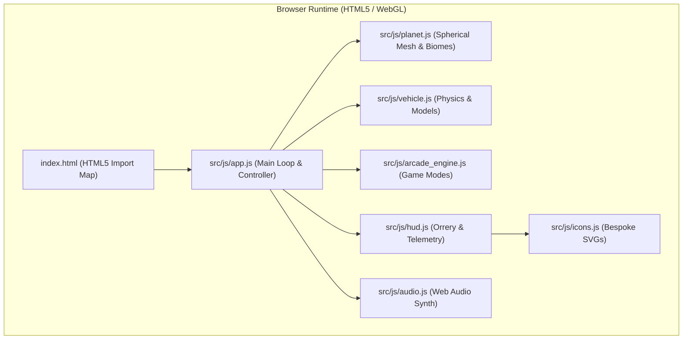
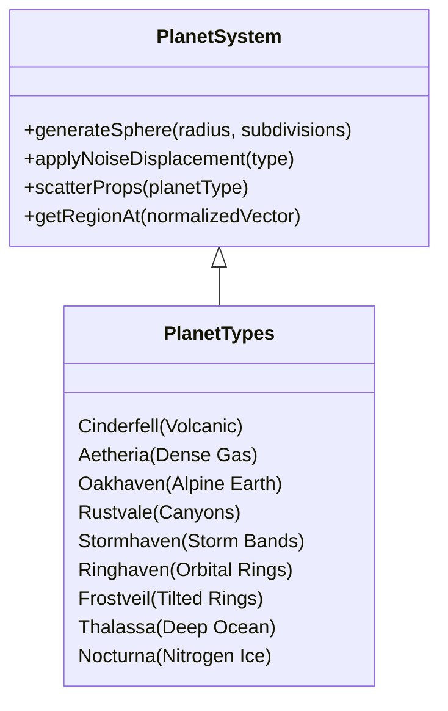
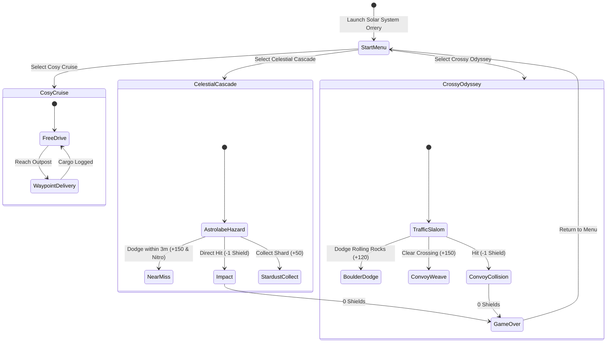

# Technical Architecture & Engine Specification

**Over The Horizon** is built on a zero-build, zero-dependency HTML5 / WebGL foundation utilizing **Three.js (r128)** via modern ES6 modules and HTML5 Import Maps.

---

## 1. Spherical Gravity & Vehicle Physics

The vehicle dynamics operate on true spherical radial gravity where `(0, 0, 0)` is the center of the planet.

### 1.1 Gravity Vector
For any given vehicle position $\mathbf{P} \in \mathbb{R}^3$, the surface normal and gravitational pull are computed radially:

$$\hat{n} = \frac{\mathbf{P}}{\|\mathbf{P}\|}, \quad \mathbf{g} = -g \cdot \hat{n}$$

### 1.2 Suspension & Surface Orientation
1. **Raycasting**: Four independent raycasts originate from the suspension mounting points toward the planet core.
2. **Spring-Damper Model**: Compression $x = \text{restLength} - \text{contactDistance}$, force $F = -k \cdot x - c \cdot v_{\text{vertical}}$.
3. **Vehicle Orientation**: The vehicle's `up` vector is smoothly aligned to the interpolated contact normal using spherical linear interpolation (SLERP), preventing flipping while maintaining responsive steering along the curved horizon.
4. **Ackermann Steering**: Front wheels calculate differential angles based on the wheelbase and turning radius, with dynamic speed damping at higher velocities.

---

## 2. 9-Planet Planetary Generator

All 9 planetary bodies are procedurally generated spherical meshes with custom vertex noise displacement, flat-shaded face normals, and biome vertex colors.

### 2.1 Planetary Roster
| Planet | Solar Index | Equivalent | Biome & Atmosphere | Unique Vehicle |
| :--- | :--- | :--- | :--- | :--- |
| **Cinderfell** | 1 | Mercury | Scorched basalt, glowing lava fissures, high heat | *Obsidian Lava Crawler* |
| **Aetheria** | 2 | Venus | Golden dense swirling smog, high pressure | *Aether Stratospheric Skimmer* |
| **Oakhaven** | 3 | Earth | Alpine diorama, pine forests, cascading streams | *TrailScout 4x4 Rig* |
| **Rustvale** | 4 | Mars | Red dust, deep canyon trenches, dry ice caps | *Valkyrie Dune Rover* |
| **Stormhaven**| 5 | Jupiter | Giant gas sphere, chromatic storm bands, vortex | *Titan Cloud Hauler* |
| **Ringhaven** | 6 | Saturn | Low-poly golden globe with 3D faceted rings | *RingStrider Buggy* |
| **Frostveil** | 7 | Uranus | Cyan methane diorama with 82° tilted rings | *Cryo-Glider Half-Track* |
| **Thalassa**  | 8 | Neptune | Cobalt ocean currents, high-velocity atmospheric gale | *Aquanaut Sub-Rover* |
| **Nocturna**  | 9 | Pluto | Icy nitrogen plains, crystalline spire towers | *Nocturne Crystalline Surveyor* |

---

## 3. Atmospheric Cycle & Particle Occlusion

### 3.1 Diurnal Time Scrubbing
The atmosphere controller models diurnal progression using a 24-hour cycle:
- **06:00 - 09:00**: Morning twilight (soft warm peach / amber rim light).
- **12:00**: Solar zenith (brilliant daylight, sharp shadows, azure sky).
- **18:00 - 19:30**: Golden hour / Sunset (rich amber and deep indigo transition).
- **00:00**: Celestial night (dark navy void, twinkling stars, illuminated headlight beams).

### 3.2 Physical Weather Occlusion
Precipitation (rain streaks, snowflakes, dust motes) is subject to physical occlusion:
- Structures (wooden cabins, outposts, bridges) maintain bounding collision boxes.
- Precipitation rays hitting vehicle roofs or interior volumes are discarded on contact, guaranteeing that precipitation **never clips through cabin ceilings or vehicle interiors**.

---

## 4. Tri-Mode Arcade Engine

### 4.1 T3 Intercept Hazard System (Celestial Cascade)
- **T3 Predictive Trajectory**: Instead of falling passively ahead of the car, incoming meteors calculate dynamic intercept vectors targeting vehicle momentum.
- **Ground Astrolabe Reticles**: Concentric rotating golden astrolabe rings project onto the planetary surface 2.5 seconds before impact.
- **Stationary Lock-on Sentry**: If the vehicle remains stationary ($\text{speed} < 5\text{ km/h}$) for more than 1.0 second, a persistent siren activates and impacts zero in directly on the vehicle coordinates.
- **Near-Miss Surge**: Passing within 1.35m to 3.2m of an active explosion grants +150 combo score and an instant 22% nitro tank refill.

### 4.2 Slalom & Convoy Dynamics (Crossy Odyssey)
- Autonomous planetary transport convoys cross intersections at varying speed intervals.
- Rolling mountain boulders detach from high slopes and roll down mountain ridges under spherical gravity.
- Successfully weaving between convoy vehicles triggers escalating combo multiplier streaks (up to 5x).

---

## 5. UI & Audio Architecture

### 5.1 HUD Architecture & Zero-Emoji Standard
- All telemetry elements utilize semantic HTML5 with custom tactile styling.
- All iconography is rendered via lightweight inline SVG vectors (`src/js/icons.js`) with zero external font dependencies or unicode emojis.
- The 3D Solar System Orrery Menu computes orbital positions dynamically and renders concentric SVG ellipses synchronized with live 3D planetary mesh previews.

### 5.2 Procedural Web Audio Engine
- Built entirely on the HTML5 `AudioContext` without external sound assets:
  - **Engine Audio**: Frequency-modulated oscillator driven dynamically by vehicle RPM and throttle input.
  - **Nitro Hiss**: Band-pass filtered white noise generator.
  - **Tire Squeal / Drift**: High-resonance modulated noise triggered by vehicle lateral slip angle.
  - **Near Miss & Chimes**: Pentatonic bell oscillators with exponential gain decay.
  - **Hazard Alarm**: Pulsating two-tone square wave siren.
