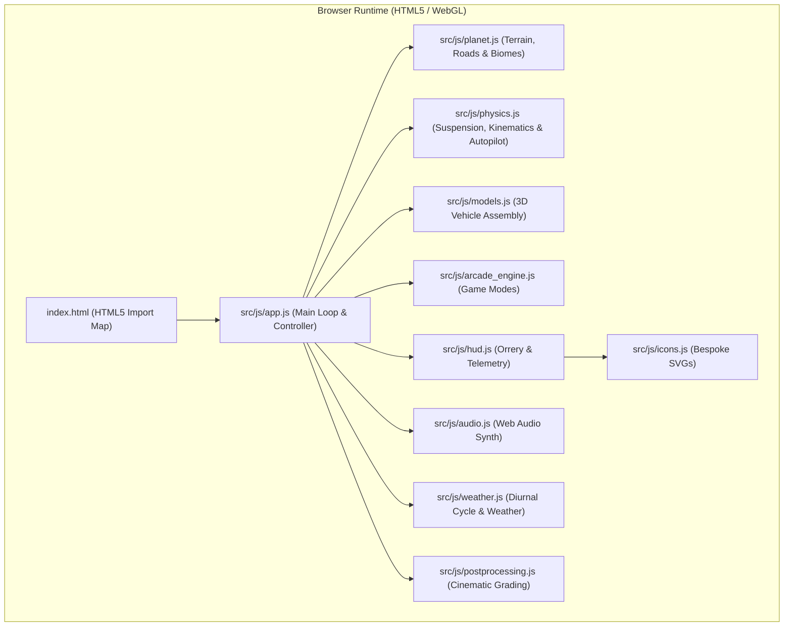
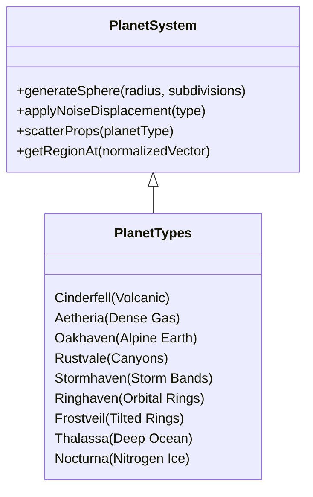
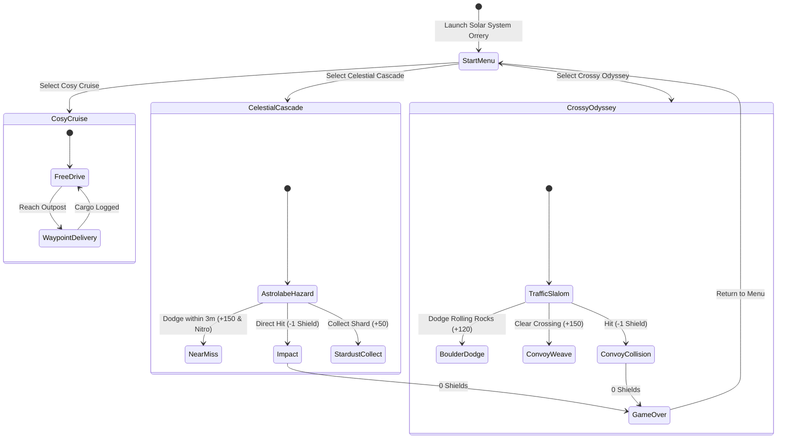

# Technical Architecture & Engine Specification

**Over The Horizon** is built on a zero-build, zero-dependency HTML5 / WebGL foundation utilizing **Three.js (r128)** via modern ES6 modules and HTML5 Import Maps.

---

## 1. Spherical Gravity & Vehicle Physics

The vehicle dynamics operate on true spherical radial gravity where `(0, 0, 0)` is the center of the planet.

### 1.1 Gravity Vector
For any given vehicle position $\mathbf{P} \in \mathbb{R}^3$, the surface normal and gravitational pull are computed radially:

$$\hat{n} = \frac{\mathbf{P}}{\|\mathbf{P}\|}, \quad \mathbf{g} = -g \cdot \hat{n}$$

### 1.2 Suspension & Surface Orientation
1. **Raycasting**: Four independent raycasts originate from the suspension mounting points toward the planet core.
2. **Spring-Damper Model**: Compression $x = \text{restLength} - \text{contactDistance}$, force $F = -k \cdot x - c \cdot v_{\text{vertical}}$.
3. **Vehicle Orientation**: The vehicle's `up` vector is smoothly aligned to the interpolated contact normal using spherical linear interpolation (SLERP), preventing flipping while maintaining responsive steering along the curved horizon.
4. **Ackermann Steering**: Front wheels calculate differential angles based on the wheelbase and turning radius, with dynamic speed damping at higher velocities.

### 1.3 Autopilot 2.0 & ADAS Guidance Engine
The vehicle physics engine incorporates an autonomous driving pipeline designed specifically for 360° spherical surfaces:

1. **Predictive Lookahead Steering**:
   Rather than reacting purely to cross-track error at the vehicle's current position, the guidance controller looks ahead by distance $L = 4.5\text{m}$ along the planet's spherical circumference:
   $$\Delta\theta = \frac{L}{R_{\text{planet}}}, \quad \theta_{\text{ahead}} = \theta + \Delta\theta$$
   The target tangent $\vec{T}(\theta_{\text{ahead}})$ and center latitude $\phi(\theta_{\text{ahead}})$ are computed analytically. Steering blends the predictive heading with cross-track error:
   $$\vec{H}_{\text{target}} = \text{normalize}\left(\vec{T}_{\text{ahead}} + \vec{R} \cdot (e_{\text{lat}} \cdot k_{\text{p}})\right)$$
   where $k_{\text{p}} = 5.0$ and $\vec{R}$ is the local surface right vector.

2. **Forward Obstacle Proximity Radar**:
   A forward radar arc scans colliders up to $14\text{m}$ ahead. If an obstacle lies within a lateral margin of $r_{\text{obs}} + 1.8\text{m}$ of the vehicle's forward vector, a repulsive lateral steering bias is added:
   $$\vec{H}_{\text{radar}} = \vec{H}_{\text{target}} + \vec{R} \cdot \left(\text{sgn}(\text{latDist}) \cdot \text{urgency} \cdot 3.5\right)$$
   This ensures the vehicle gently hugs the opposite half of the roadbed when passing roadside landmarks without clipping verges.

3. **Resilient Barrier Deflection**:
   Glancing collisions with timber guardrails or bridge posts resolve via 2D tangential sliding with restitution $e = 0.22$. The previous engine kill-switch has been eliminated, enabling the vehicle to smoothly glance off barriers, play tactile collision audio, and maintain its cruise speed.

4. **Auto-Unstuck Watchdog**:
   If the vehicle velocity remains below $1.5\text{ m/s}$ for more than $1.8\text{ s}$ outside of initial launch grace ($3.0\text{ s}$), the watchdog automatically executes a $0.75\text{ s}$ reverse-and-pivot maneuver with counter-steering lock, freeing the chassis from wedging before resuming forward cruise.

---

## 2. 9-Planet Planetary Generator

All 9 planetary bodies are procedurally generated spherical meshes with custom vertex noise displacement, flat-shaded face normals, and biome vertex colors.

### 2.1 Planetary Roster
| Planet | Solar Index | Equivalent | Biome & Atmosphere | Unique Vehicle |
| :--- | :--- | :--- | :--- | :--- |
| **Cinderfell** | 1 | Mercury | Scorched basalt, glowing lava fissures, high heat | *Obsidian Lava Crawler* |
| **Aetheria** | 2 | Venus | Golden dense swirling smog, high pressure | *Aether Stratospheric Skimmer* |
| **Oakhaven** | 3 | Earth | Alpine diorama, pine forests, cascading streams | *TrailScout 4x4 Rig* |
| **Rustvale** | 4 | Mars | Red dust, deep canyon trenches, dry ice caps | *Valkyrie Dune Rover* |
| **Stormhaven**| 5 | Jupiter | Giant gas sphere, chromatic storm bands, vortex | *Titan Cloud Hauler* |
| **Ringhaven** | 6 | Saturn | Low-poly golden globe with 3D faceted rings | *RingStrider Buggy* |
| **Frostveil** | 7 | Uranus | Cyan methane diorama with 82° tilted rings | *Cryo-Glider Half-Track* |
| **Thalassa**  | 8 | Neptune | Cobalt ocean currents, high-velocity atmospheric gale | *Aquanaut Sub-Rover* |
| **Nocturna**  | 9 | Pluto | Icy nitrogen plains, crystalline spire towers | *Nocturne Crystalline Surveyor* |

### 2.2 Analytical Road Coordinates & 7.5m+ Safety Corridors
Every planetary body defines a continuous mathematical road loop around its spherical circumference:

1. **Analytical Geodesic Equations**:
   Road latitude $\phi(\theta)$ and derivative $\frac{d\phi}{d\theta}$ are defined tailored to each world's topology:
   - **Oakhaven**: $\phi = 0.22\sin(4\theta + 0.35) + 0.07\cos(2\theta)$
   - **Rustvale**: $\phi = 0.24\sin(3.5\theta + 0.5) + 0.09\cos(2\theta)$
   - **Cinderfell**: $\phi = 0.18\sin(3\theta + 0.2) + 0.08\cos(4\theta)$
   - **Stormhaven**: $\phi = 0.15\sin(2.5\theta + 0.4) + 0.06\cos(3\theta)$
   - **Ringhaven**: $\phi = 0.20\sin(3\theta) + 0.08\cos(2\theta)$
   - **Frostveil**: $\phi = 0.22\sin(3.5\theta - 0.3) + 0.08\cos(2\theta)$
   - **Thalassa**: $\phi = 0.20\sin(3\theta + 0.6) + 0.09\cos(2\theta)$
   - **Nocturna**: $\phi = 0.22\sin(3\theta + 0.1) + 0.07\cos(2\theta)$
   - **Aetheria**: $\phi = 0.19\sin(3.2\theta + 0.3) + 0.08\cos(2\theta)$

2. **True 3D Surface-Orthogonal Lateral Vectors**:
   For any road point $\vec{P}(\theta)$, the surface normal $\vec{N}$ and tangent $\vec{T}$ define the lateral roadside vector:
   $$\vec{R}(\theta) = \frac{\vec{T}(\theta) \times \vec{N}(\theta)}{\|\vec{T}(\theta) \times \vec{N}(\theta)\|}$$
   This guarantees that lateral displacements lie strictly on the tangent plane of the sphere, eliminating 3D perspective distortion that previously pulled roadside landmarks onto the road.

3. **Roadbed Flattening & Corridor Blending**:
   Terrain elevation $E(u)$ at any unit spherical coordinate $u$ blends the natural procedural noise into a smooth, leveled roadbed:
   $$\text{distRoad} = |\arcsin(u_y) - \phi(\theta)|$$
   $$\text{roadFactor} = \text{smoothstep}(\text{distRoad}, 0.065, 0.145)$$
   $$E_{\text{final}} = \text{lerp}(E_{\text{road}}, E_{\text{terrain}}, \text{roadFactor})$$
   This produces an $8.4\text{m}$ perfectly flat inner driving lane with a gentle $10\text{m}$ transition shoulder, eliminating road edge potholes and polygon drop-offs.

4. **Strict 7.5m+ Obstacle Exclusion Zone**:
   All environmental architecture and colliders adhere to an exclusion corridor:
   - **Alien Research Domes & Pylons**: Lateral offset $\pm 0.155$ (~$10.1\text{m}$), providing $>7.5\text{m}$ clear buffer from the road center.
   - **Verge Lanterns**: Positioned at offset $\pm 0.098$ ($6.4\text{m}$), safely on the outer grass verge beyond the $4.0\text{m}$ road half-width.
   - **Bridge Railings**: Calibrated to width $\pm 2.6\text{m}$, granting ample clearance for the $2.1\text{m}$ vehicle envelope.

---

## 3. Atmospheric Cycle & Particle Occlusion

### 3.1 Diurnal Time Scrubbing
The atmosphere controller models diurnal progression using a 24-hour cycle:
- **06:00 - 09:00**: Morning twilight (soft warm peach / amber rim light).
- **12:00**: Solar zenith (brilliant daylight, sharp shadows, azure sky).
- **18:00 - 19:30**: Golden hour / Sunset (rich amber and deep indigo transition).
- **00:00**: Celestial night (dark navy void, twinkling stars, illuminated headlight beams).

### 3.2 Physical Weather Occlusion
Precipitation (rain streaks, snowflakes, dust motes) is subject to physical occlusion:
- Structures (wooden cabins, outposts, bridges) maintain bounding collision boxes.
- Precipitation rays hitting vehicle roofs or interior volumes are discarded on contact, guaranteeing that precipitation **never clips through cabin ceilings or vehicle interiors**.

---

## 4. Tri-Mode Arcade Engine

### 4.1 T3 Intercept Hazard System (Celestial Cascade)
- **T3 Predictive Trajectory**: Instead of falling passively ahead of the car, incoming meteors calculate dynamic intercept vectors targeting vehicle momentum.
- **Ground Astrolabe Reticles**: Concentric rotating golden astrolabe rings project onto the planetary surface 2.5 seconds before impact.
- **Stationary Lock-on Sentry**: If the vehicle remains stationary ($\text{speed} < 5\text{ km/h}$) for more than 1.0 second, a persistent siren activates and impacts zero in directly on the vehicle coordinates.
- **Near-Miss Surge**: Passing within 1.35m to 3.2m of an active explosion grants +150 combo score and an instant 22% nitro tank refill.

### 4.2 Slalom & Convoy Dynamics (Crossy Odyssey)
- Autonomous planetary transport convoys cross intersections at varying speed intervals.
- Rolling mountain boulders detach from high slopes and roll down mountain ridges under spherical gravity.
- Successfully weaving between convoy vehicles triggers escalating combo multiplier streaks (up to 5x).

---

## 5. UI & Audio Architecture

### 5.1 HUD Architecture & Zero-Emoji Standard
- All telemetry elements utilize semantic HTML5 with custom tactile styling.
- All iconography is rendered via lightweight inline SVG vectors (`src/js/icons.js`) with zero external font dependencies or unicode emojis.
- The **Diegetic 3D Planetary Carousel Menu** renders real-time 3D planetary mesh viewports directly on the screen with tactile navigation dots, mode chips, and prominent candy amber CTA controls.
- The dual-tab **Expedition Field Guide & Dev Dossier** (`#about-modal`) presents game mechanics, vehicle blueprints, creator history, and live project telemetry.

### 5.2 Procedural Web Audio Engine
- Built entirely on the HTML5 `AudioContext` without external sound assets (0KB download footprint):
  - **Engine Audio**: Frequency-modulated oscillator driven dynamically by vehicle RPM and throttle input.
  - **Nitro Hiss**: Band-pass filtered white noise generator.
  - **Tire Squeal / Drift**: High-resonance modulated noise triggered by vehicle lateral slip angle.
  - **Near Miss & Chimes**: Pentatonic bell oscillators with exponential gain decay.
  - **Hazard Alarm**: Pulsating two-tone square wave siren.
  - **Procedural Planetary Soundtracks**: Dynamic real-time algorithmic chords across Pentatonic, Dorian, and Lydian modal scales tailored to each world.
  - **Sound Calibration Drawer**: Menu-exclusive volume drawer with independent Master, Music, and SFX/Engine gain stages and live calibration feedback blips.
  - **Hardware Audio Unlocker**: Silent buffer pre-warming on initial touch to comply with mobile WebKit audio policies.

---

## 6. Interactive 360° Camera & Cockpit POV

### 6.1 Spherical Orbit Drag with Inertial Momentum
- Players can drag across the viewport via touch or mouse to rotate the camera around the vehicle in 360°.
- Camera angles operate on a spherical orbit frame aligned to the planet's surface normal:
  $$\vec{C}_{\text{pos}} = \vec{P}_{\text{vehicle}} + \mathbf{R}_{\text{surface}}(\alpha, \beta) \cdot \vec{d}_{\text{offset}}$$
- Dynamic pitch clamping ($[-10^\circ, +82^\circ]$) prevents the camera from clipping into subterranean planet geometry when dragging below the horizon.
- Inertial release momentum smoothly decelerates rotation when touch or mouse drag ends.

### 6.2 Restricted Wide-Angle Cockpit View
- When toggled to **Cockpit Mode** (`C` key / POV button), the camera anchors to the vehicle's driver seat coordinate.
- To prevent disorienting reverse flips and seat clipping, camera rotation is restricted to a realistic wide-angle driver field:
  - **Azimuth Range**: $[-75^\circ, +75^\circ]$ relative to the vehicle heading.
  - **Pitch Range**: $[-15^\circ, +25^\circ]$ relative to the vehicle dashboard plane.
  - Smooth spring-damper return aligns the view forward when orbit input is released.

---

## 7. Edge-to-Edge Mobile & PWA Scaffold

### 7.1 Thumb-Zone Ergonomics & Speedometer Docking
- On mobile devices and tablets, the Speedometer Cluster automatically docks to the bottom-left edge directly adjacent to the steering pedals.
- This creates an ergonomic **Left-Docked Thumb Zone**, keeping the center and upper screen 100% open for uninterrupted 3D diorama viewing.

### 7.2 Safe Area Insets & Status Bar Styling
- Full integration with Apple WebKit Dynamic Island and notch margins using CSS `env(safe-area-inset-top)`, `env(safe-area-inset-bottom)`, `env(safe-area-inset-left)`, and `env(safe-area-inset-right)`.
- Set `<meta name="apple-mobile-web-app-status-bar-style" content="default">` with solid `#090D16` theme color, eliminating iOS progressive frosted-glass blur over the top screen edge.

---

## 8. Analytics & Diagnostics Engine

- Integrated **Microsoft Clarity** session diagnostics and user journey tracking (Project ID: `yznpugasgn`).
- Asynchronously logs interaction heatmaps, performance timings, and user journeys with zero frame impact on the WebGL render loop.
- Client-side error telemetry overlay captures startup WebGL issues and provides actionable guidance for mobile Chrome/iOS local network permissions.
