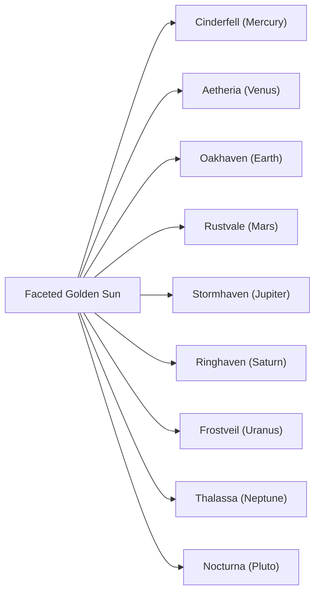
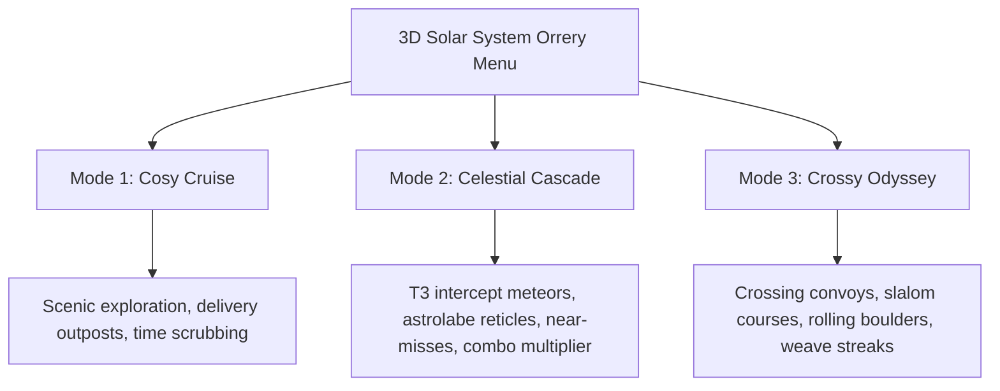

# Over The Horizon: Master Game Design Document

**An Alpine & 9-Planet Low-Poly Driving Odyssey**

> [!IMPORTANT]
> **PROPRIETARY & CONFIDENTIAL — ALL RIGHTS RESERVED**
> Copyright © 2026 Over The Horizon Creators. This document, game design specifications, planetary lore, storylines, and creative mechanics are proprietary intellectual property. No permission is granted to reproduce, copy, or create derivative games using these concepts.

---

## 1. Executive Summary & Vision

**Over The Horizon** is a stylized, spherical-gravity driving adventure that pairs the warm, tactile charm of miniature low-poly dioramas (*Art of Rally*, *Firewatch*, *A Short Hike*) with tight vehicle physics and dynamic arcade challenges.

Players explore a complete 9-planet solar system—anchored by the lush alpine diorama of **Oakhaven (Earth)**—navigating curved horizons in planetary exploration rigs under true spherical radial gravity.

---

## 2. The 9-Planet Solar System Roster

Each world is an independent miniature spherical diorama with its own distinct geological biome, climate parameters, and bespoke exploration vehicle.

### 1. Cinderfell (Mercury Equivalent)
* **Visual Style:** Scorched charcoal basalt with glowing amber lava fissures, obsidian crags, and heat distortion ripples.
* **Vehicle:** *Obsidian Lava Crawler* — Heavy 6-wheel articulated crawler with heat-resistant treads.
* **Atmosphere:** Void vacuum, harsh solar radiation glare, zero clouds.

### 2. Aetheria (Venus Equivalent)
* **Visual Style:** Golden sulfuric atmosphere with swirling cloud bands, dense acid mist, and amber stone monoliths.
* **Vehicle:** *Aether Stratospheric Skimmer* — Streamlined low-drag high-pressure hover buggy.
* **Atmosphere:** High-density amber fog, heavy greenhouse atmospheric scattering.

### 3. Oakhaven (Earth)
* **Visual Style:** Lush alpine national park diorama. Low-poly faceted emerald pine trees, crystalline mountain streams, rustic wooden bridges, and cozy log cabins.
* **Vehicle:** *TrailScout 4x4 Rig* — Classic 1970s overland utility truck with high-travel suspension, roof rack, and rear spare tire.
* **Atmosphere:** Earth-like troposphere with dynamic diurnal sunlight, drifting cumulus clouds, gentle rain, and mountain blizzards.

### 4. Rustvale (Mars Equivalent)
* **Visual Style:** Deep crimson iron-oxide canyons, jagged sandstone spires, sweeping orange dunes, and frozen polar dry-ice caps.
* **Vehicle:** *Valkyrie Dune Rover* — Long-travel sand buggy with massive balloon paddle tires.
* **Atmosphere:** Thin pink-orange sky, swirling red dust devils.

### 5. Stormhaven (Jupiter Equivalent)
* **Visual Style:** Colossal gas giant diorama with chromatic storm bands, deep bronze and ivory turbulence swirls, and a Great Storm Vortex.
* **Vehicle:** *Titan Cloud Hauler* — Multi-rotor atmospheric cargo hauler engineered for dense cloud currents.
* **Atmosphere:** Continuous atmospheric turbulence, ambient lightning flashes.

### 6. Ringhaven (Saturn Equivalent)
* **Visual Style:** Golden planetary sphere encircled by majestic low-poly 3D faceted orbital rings composed of spinning ice boulders.
* **Vehicle:** *RingStrider Buggy* — Ultra-wide low-gravity sprint buggy with stabilization outriggers.
* **Atmosphere:** Serene golden sky with constant silhouettes of overhead rings.

### 7. Frostveil (Uranus Equivalent)
* **Visual Style:** Pale cyan methane ice diorama featuring a dramatic 82° steeply tilted ring disc.
* **Vehicle:** *Cryo-Glider Half-Track* — Twin front steering skis with rear caterpillar tracks for zero-friction ice gliding.
* **Atmosphere:** Pale aquamarine haze with diamond dust precipitation.

### 8. Thalassa (Neptune Equivalent)
* **Visual Style:** Deep cobalt and ultramarine liquid world with rolling tidal swells and submerged crystalline reefs.
* **Vehicle:** *Aquanaut Sub-Rover* — Dual-environment amphibious hull with deployable hydro-propellers.
* **Atmosphere:** High-velocity cobalt winds with heavy oceanic squalls.

### 9. Nocturna (Pluto Equivalent)
* **Visual Style:** Outer-rim dwarf planet diorama composed of faceted nitrogen ice plains, glowing violet geysers, and dark crystalline peaks.
* **Vehicle:** *Nocturne Crystalline Surveyor* — Low-profile scientific scout with high-intensity floodlights.
* **Atmosphere:** Deep cosmic night, twinkling constellations, and glowing stardust motes.

---

## 3. The Tri-Mode Gameplay Architecture

### Mode 1: Cosy Cruise
* **Core Philosophy:** Pure scenic exploration and relaxed driving with no timers or damage pressure.
* **Objectives:** Traverse winding trails, navigate mountain bridges, discover scenic viewpoints, and log delivery waypoints.
* **Atmosphere Dial:** Players can dynamically scrub the 24-hour diurnal cycle (Dawn, Midday, Sunset, Midnight) and toggle weather states (Clear Sun, Rain, Snow, Dust).

### Mode 2: Celestial Cascade
* **Core Philosophy:** Dynamic sky hazard survival and precision evasion.
* **Mechanics:**
  * **T3 Intercept Vectors:** Incoming celestial bodies calculate predictive intercept angles targeting vehicle trajectory.
  * **Ground Astrolabe Reticles:** Geometric rotating gold astrolabe rings project onto terrain 2.5s before impact.
  * **Near-Miss Surge:** Passing within 1.35m–3.2m of an impact triggers a +150 point bonus and refills 22% of the nitro energy reserve.
  * **Stardust Shards:** Impacts scatter collectible stardust shards (+50 pts) that extend combo timers.
  * **Stationary Lock-on Sentry:** Idling for >1.0s triggers an audible siren and focuses direct impacts onto the vehicle.
  * **Shield Matrix:** Vehicles possess 3 holographic shield charges before experiencing a mission failure.

### Mode 3: Crossy Odyssey
* **Core Philosophy:** Reflex-driven traffic slalom and boulder avoidance.
* **Mechanics:**
  * **Crossing Convoys:** Multi-lane transport vehicles traverse key intersections across the planet.
  * **Rolling Boulders:** Giant faceted boulders detach from mountain peaks and roll across trails under spherical gravity.
  * **Clean Weaves:** Threading through convoy gaps triggers escalating combo multipliers (up to 5x).

---

## 4. Vehicle Physics & Control Specification

* **Radial Spherical Gravity:** Gravity pulls continuously toward the planet's mathematical center `(0, 0, 0)`.
* **4-Wheel Independent Suspension:** Spring-damper raycasting maintains ground contact and prevents clipping through terrain polygons.
* **Steering & Drift:** Ackermann geometry with dynamic high-speed stability damping. Nitro boosts deliver instant acceleration surges with procedural exhaust particles.
* **Control Schemes:**
  - **Keyboard:** `W/A/S/D` or Arrow Keys (Drive & Steer), `SPACE` (Nitro Boost), `S` (Brake), `C` (Camera), `P` (Autopilot Cruise), `H` (Horn), `M` (Solar System Menu).
  - **Mobile:** On-screen virtual directional steering pads and tactile Nitro / Brake / Gas action buttons.

---

## 5. User Interface & Presentation Standards

1. **Tactile Mechanical Keycaps:** Controls guide uses beveled 3D mechanical keys with top highlights and bottom shadow bevels.
2. **Digital Speedometer Cluster:** Large tabular numeral speed indicator with cyan glow, segmented nitro energy bar, and autopilot indicator.
3. **Diurnal Atmosphere Console:** Celestial gradient scrubber with glowing sun bead thumb and bespoke SVG weather capsules (Sun, Rain, 6-point dendritic Snowflake, Dust).
4. **Interactive 3D Solar System Orrery:** Central faceted golden Sun, 9 concentric orbital ellipses, leader lines, and live scenic docket previews.
5. **Zero-Emoji Mandate:** 100% of telemetry, headers, rankings, and notification toasts utilize bespoke SVG vectors or typography.
